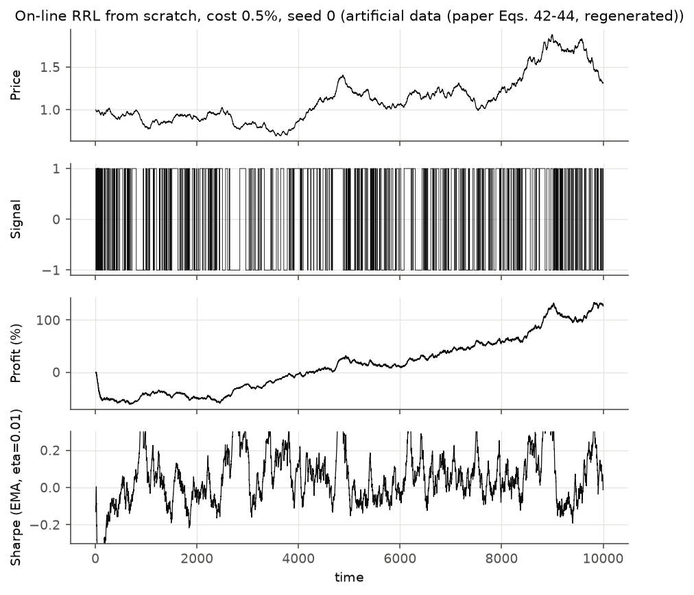
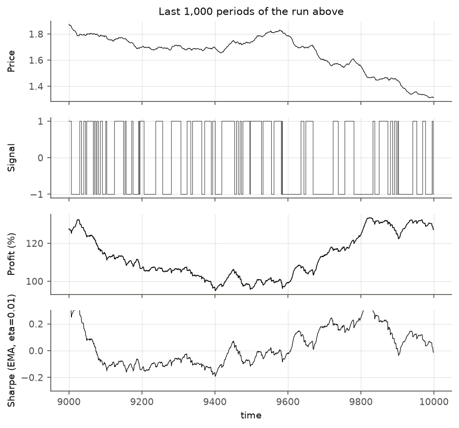
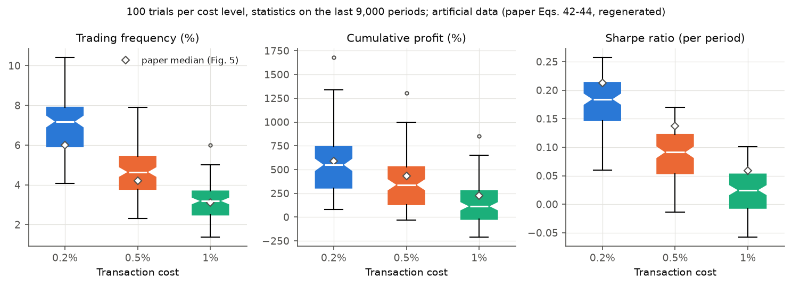
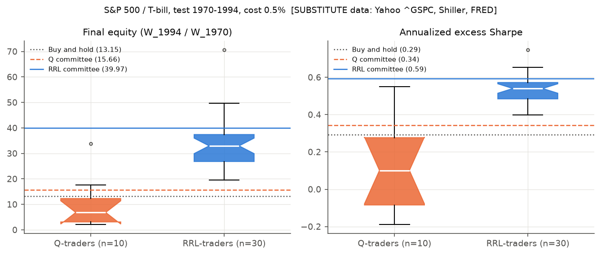
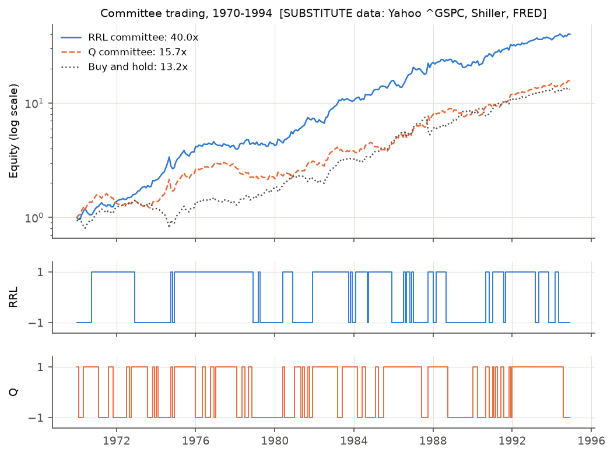
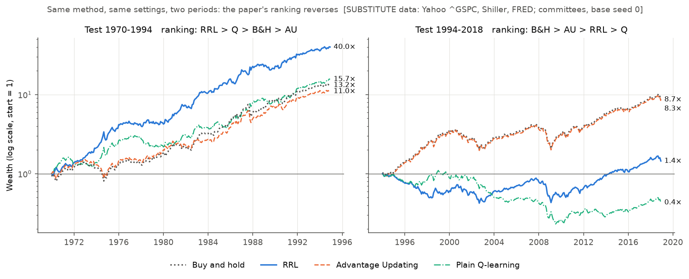
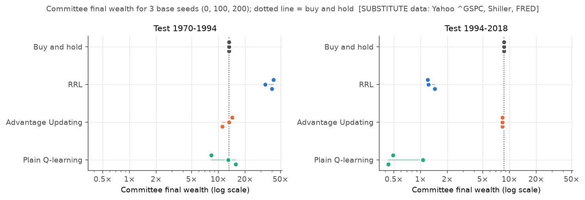
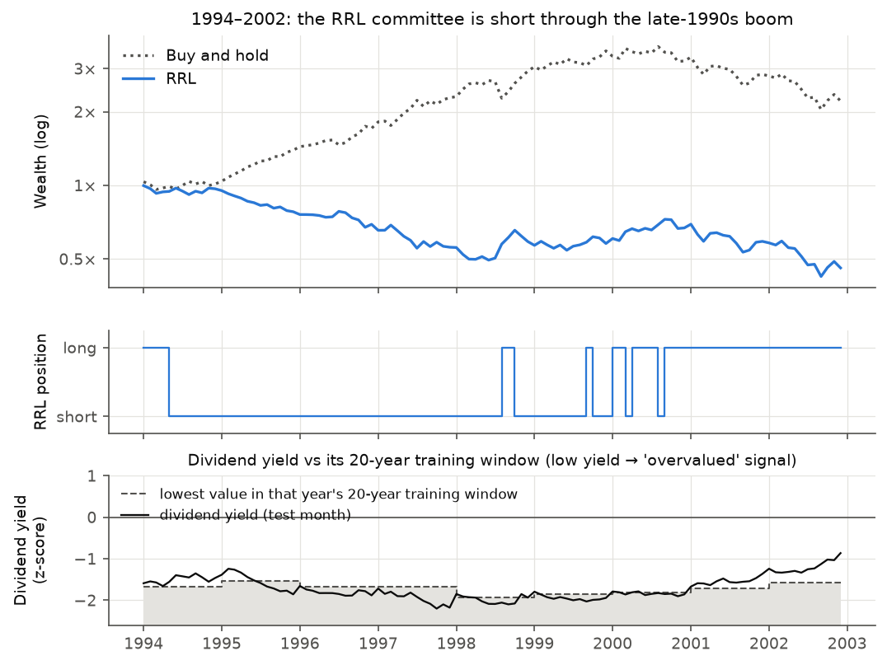

# Recurrent RL Trader.

Implementation of Moody & Saffell, *Learning to Trade via Direct Reinforcement*, IEEE Trans. Neural Networks 12(4), 2001.


-------

## Method
Basically, a trader is a single recurrent tanh unit, `F_t = sign(tanh(θ · [1, x_t, F_{t−1}]))`, that takes a long (+1) or short (−1) positions. Its trading return is `R_t = F_{t−1} r_t − δ |F_t − F_{t−1}|`: which is just the profit from the position held over the period, minus the cost of changing it. Instead of forecasting prices or learning a value function, **Recurrent Reinforcement Learning (RRL)** adjusts θ by gradient ascent directly on a trading performance measure. We use both the **differential Sharpe ratio** `D_t`, the first-order effect of the latest return on an exponential moving Sharpe ratio, and **differential downside deviation ratio** (analogous to sterling ratio just because it is kinda harder to deal with minimizing drawdowns.) which allows on-line updates. The paper also compares this direct reinforcement approach with Q-learning on monthly S&P 500 / T-bill allocation.

Here is the [paper](https://ieeexplore.ieee.org/document/935097).

## Layout and how to run

```
src/data_synthetic.py   artificial prices (Eqs. 42-44)    src/rrl.py         RRL trader, hand-derived gradients
src/returns.py          R_t and dR/dF (Eqs. 6, 7)         src/rrl_torch.py   autograd reference (tests only)
src/dsr.py              differential Sharpe (Eqs. 14-16)  src/q_trader.py    Q-learning baseline
src/metrics.py          Sharpe, equity, drawdown          src/data_sp500.py  substitute S&P/T-bill dataset
experiments/exp1_synthetic.py   Sec. IV-A (Figs. 2, 3, 5)
experiments/exp2_sp500.py       Sec. IV-C (Figs. 8, 9)
experiments/fetch_data.py       downloads the substitute data for Exp. 2
```

```bash
python -m venv .venv && .venv/bin/pip install -r requirements.txt
.venv/bin/python -m pytest                                 # 23 tests, ~3 s
.venv/bin/python experiments/exp1_synthetic.py --seed 0    # ~1 min on 8 cores
.venv/bin/python experiments/fetch_data.py                 # once
.venv/bin/python experiments/exp2_sp500.py --seed 0        # ~1 min on 8 cores
.venv/bin/jupyter lab notebooks/results.ipynb              # browse all results (reads results/, no retraining)
```

Every assumption, ambiguity and data source is in [NOTES.md](NOTES.md).

## Tests (Milestone 1)
- **Gradients.** The hand-derived batch gradient of the Sharpe ratio matches central finite differences and **PyTorch autograd BPTT** (rtol 1e-5, float64), for additive and multiplicative returns and for continuous and discrete (straight-through) traders. The on-line per-step updates sum to the autograd gradient of Σ D_t with A, B detached. Dropping the recurrent term `dF_{t−1}/dθ` gives a gradient that is measurably wrong.
- **Zero-cost sanity:** positive learned Sharpe.
- **No look-ahead:** changing data after t does not change `F_{≤t}` or `R_{≤t}`, and `R_t = F_{t−1} r_t − δ|ΔF_t|` exactly. S&P features at month t are unchanged when later prices change, and normalization uses only the training window.
- **Determinism:** the same seed gives identical results.

## Experiment 1: artificial price series (paper Sec. IV-A)

Data: regenerated from the paper's process, `p(t) = p(t−1) + β(t−1) + 3ε(t)`, `β(t) = 0.9β(t−1) + ν(t)`, `z = exp(p/R)`.

**Single trader learning on-line from scratch, cost 0.5%** (compare with paper Figs. 2 and 3):




As in the paper, the trader loses money while it learns from scratch, then profits steadily: about +130% cumulative over 10,000 periods, vs about +200% in the paper's run. Our last-1,000-period window (Fig. 3) includes a losing stretch, unlike the window shown in the paper. We show seed 0 rather than picking a good-looking seed.

**100 trials per cost level** (fresh series and random initial weights each trial; 100 training epochs on the first 1,000 samples, then on-line learning through the test set; statistics on the last 9,000 periods). Diamonds are the paper's medians, read off Fig. 5:



| Cost | Trade freq. % (ours / paper) | Cum. profit % (ours / paper) | Sharpe per period (ours / paper) | Trials with Sharpe > 0 (ours / paper) |
|---|---|---|---|---|
| 0.2% | 7.2 / ~6.0 | 550 / ~590 | 0.184 / ~0.213 | 100% / 100% |
| 0.5% | 4.6 / ~4.2 | 340 / ~430 | 0.091 / ~0.137 | 98% / 100% |
| 1.0% | 3.2 / ~3.1 | 114 / ~225 | 0.025 / ~0.059 | 70% / 100% |

(Medians over 100 trials. The paper's values are approximate, read from box plots.)

**Reproduced:** RRL learns profitable strategies on this data, and trading frequency, profit and Sharpe all fall as costs rise. Trading frequencies match the paper closely.
**Not fully reproduced:** our Sharpe ratios and profits are lower, and the gap grows with cost. At 1% cost, 30% of our trials have a negative Sharpe, while the paper reports all positive. At zero cost our trader matches an oracle-like linear predictor (Sharpe 0.34), so the signal is learned. The shortfall is in *when* to trade under costs. Learning rate, input scaling and start-up handling are not in the paper; see NOTES.md for what we tried.

## Experiment 2: S&P 500 / T-bill allocation, RRL vs Q-learning (paper Sec. IV-C)

> **SUBSTITUTE DATA.** The paper used 84 Citibase series that we do not have. We use 16 inputs built from public data (Yahoo month-end S&P 500 closes, Shiller dividends/earnings/CPI/10-year yield, FRED T-bill/AAA/BAA/industrial production/unemployment). **These are not results on the paper's data.**

Same protocol as the paper:
- 1970–1994 out of sample, with yearly retraining on the previous 20 years (10 to train, 10 to validate and early-stop).
- Cost 0.5%, multiplicative wealth, and shorts earn twice the T-bill rate.
- 30 RRL traders (single tanh unit) and 10 Q-traders (30 hidden tanh units), each set combined by majority vote.




| 1970–1994, cost 0.5% | Final equity (ours / paper) | Ann. excess Sharpe (ours / paper) | Max drawdown | Trades (% of months) |
|---|---|---|---|---|
| Buy and hold | 13.2× / 13.5× | 0.29 / 0.34 | 43% | 0 |
| **RRL committee (30)** | **40.0× / 58.6×** | **0.59 / 0.83** | 21% | 13.0 |
| Q committee (10) | 15.7× / 33.6× | 0.34 / 0.63 | 29% | 20.7 |
| RRL traders, median [IQR] | 33.0× [26.8, 37.4] / ~41× | 0.54 [0.48, 0.57] | 21% | 13.7 |
| Q traders, median [IQR] | 6.8× [3.1, 12.3] / ~24× | 0.10 [−0.08, 0.28] | 29% | 24.3 |

Robustness across base seeds (whole experiment re-run):

| Base seed | RRL committee | Q committee | Buy and hold |
|---|---|---|---|
| 0 (reported) | 40.0× | 15.7× | 13.2× |
| 100 | 33.6× | 12.9× | 13.2× |
| 200 | 41.5× | 8.3× | 13.2× |

**Reproduced:**
- The RRL trader clearly beats buy-and-hold, with all 30 individual traders above it, about twice the Sharpe and half the drawdown.
- The RRL trader beats the Q-trader in every seed, and the Q-trader trades more often.
- As in the paper, much of the RRL edge comes from being short (and earning 2× the T-bill rate) during the high-rate 1970s–80s. The committee is short 42% of all months, 92% of 1973–74, and 56% of Jul 1987–Mar 1988.

**Not reproduced:** the paper's Q-trader also beats buy-and-hold comfortably (33.6×). Ours is roughly level with buy-and-hold or worse, depending on the seed, and the typical individual Q-trader is below it. Likely reasons:
- we use plain Q-learning instead of the paper's Advantage Updating;
- the Q hyperparameters are unpublished, and our pre-1970 pilot could not distinguish between settings;
- the substitute inputs differ.

The Q result was also sensitive to setup: 2.5×–15.7× across the three configurations we ran (NOTES.md, "Exp. 2 history").

### Added 2026-11-10: Advantage Updating, and a later test period (1994–2018)

Full write-up: `docs/exp2_walkthrough.md`. Still **substitute data**. All settings are frozen at their pre-1970 values.

| Committee final wealth, base seeds 0 / 100 / 200 | 1970–1994 | 1994–2018 |
|---|---|---|
| Buy and hold | 13.2× | 8.7× |
| RRL | 40.0 / 33.6 / 41.5× | 1.4 / 1.2 / 1.2× |
| Plain Q-learning | 15.7 / 12.9 / 8.3× | 0.4 / 1.1 / 0.5× |
| Advantage Updating (the paper's Q-trader) | 11.0 / 13.1 / 14.2× | 8.3 / 8.3 / 8.3× |

- **Advantage Updating** (`src/advantage_updating.py`, `--q-method au`) did not reach the paper's Q-trader result (33.6×). It stays long almost all the time and so tracks buy-and-hold.
- **On 1994–2018 the paper's ranking reverses:** RRL loses heavily to buy-and-hold. It was short through the 1995–99 boom, when the dividend yield was ~2 std below its training mean (at or just below the training-window minimum), a valuation signal that had worked before and stopped working. This is the likely explanation, not a proven one: the yield stays as low in 2000, when the trader goes long again. T-bill rates near 0% after 2008 also removed the advantage of being short (shorts earn 2× T-bill).





## Experiment 3: USD/GBP FX {long, short, neutral} trader (paper Sec. IV-B)

> **SUBSTITUTE DATA: HistData.com GBP/USD bid/ask ticks, Jan–Aug 2010** (pilot: Sep–Dec 2009).
> The paper used Olsen HFDF96 quotes for Jan–Aug 1996, which are commercial. **Not a replication on the original data.**

Half-hourly bars, three positions, trades at the bid/ask, objective = differential downside deviation
ratio (Eqs. 21–24). Train on 2,000 bars, trade the next 480 (2 weeks), slide, retrain. 25 traders (seeds 0–24).

```
python experiments/exp3_pilot.py --seed 100     # chooses rho, epochs on Sep-Dec 2009 only
python experiments/exp3_fx.py --seed 0          # 25 traders on Jan-Aug 2010
python experiments/exp3_diagnose.py --seed 0    # splits returns into gross profit and spread cost
```

| | Ours (median of 25) | Paper (one trader) |
|---|---|---|
| Annualized return | −55% | 15% |
| Annualized Sharpe | −4.5 | 2.3 |
| Hours between trades | 3.6 | about 5 |
| Traders with positive Sharpe | 0 / 25 | — |
| Holding GBP long (baseline) | +6.2%, Sharpe 0.51 | — |

**The paper's FX result is not reproduced.** Two reasons (`results/exp3_fx/exp3_cost_decomposition.txt`):
1. **No edge out of sample:** before costs the median trader makes −3.9% a year; with zero cost it has a median Sharpe of 0.07.
2. **Costs dominate:** it trades every few hours and pays about 53% a year in spread (3–7 pips; 7 pips in Jul–Aug 2010).

Settings came from a pilot on Sep–Dec 2009 where every setting also lost money; nothing was tuned on 2010.


## Differences from the paper (summary; details in NOTES.md)
1. **Exp. 2 data is a substitute:** 16 public series instead of 84 Citibase series, month-end Yahoo prices, and our own feature set.
2. **The Q baseline:** our main runs use plain Q-learning. Advantage Updating (the paper's method) was added later; its learning rules come from Baird, since the paper doesn't give them.
3. **Learning rates, initial weights, input scaling and the DSR start-up guard are our choices.** The paper doesn't give them. They were tuned only on pilot seeds (Exp. 1) or pre-1970 data (Exp. 2), never on the reported test sets.
4. Exp. 1 uses the same 100 price series at each cost level (paired).
5. Milestone 4 (USD/GBP FX): the paper's Olsen 1996 data is proprietary, so we used HistData GBP/USD bid/ask ticks from 2010. The result is not reproduced (median −55% a year vs the paper's +15%). See the Experiment 3 section and NOTES.md.
