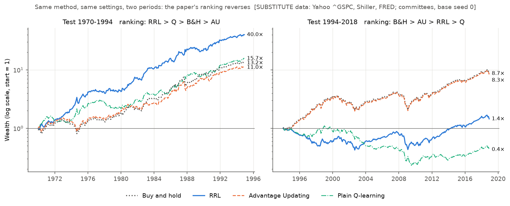
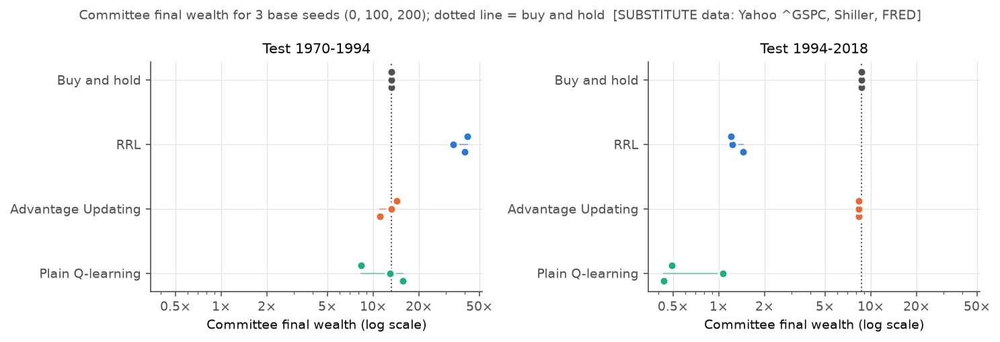
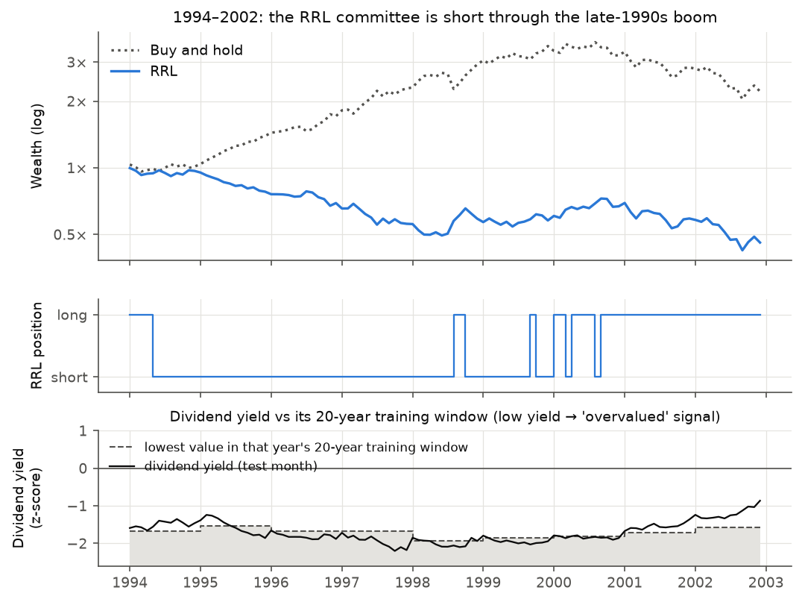

# Experiment 2 walkthrough: S&P 500 / T-bill, RRL vs Q-learning (paper Sec. IV-C)

Notes for the presentation. Written 2026-11-10. Details of every choice are in `NOTES.md`.

> **SUBSTITUTE DATA.** The paper used 84 Citibase series that are not publicly available
> (Citibase is a commercial database). Every result here uses 16 inputs built from public data
> (Yahoo S&P 500 prices, Shiller dividends/earnings/CPI/10-year yield, FRED interest rates and
> macro series). **These are not results on the paper's data.**

Regenerate everything (each run takes about 40 s on 8 cores):
```
python experiments/exp2_sp500.py --seed 0                          # paper period, plain Q-learning
python experiments/exp2_sp500.py --seed 0 --q-method au            # paper period, Advantage Updating
python experiments/exp2_sp500.py --seed 0 --q-method au --test-start 1994 --test-end 2018
python experiments/exp2_sp500.py --seed 0 --q-method q  --test-start 1994 --test-end 2018
python experiments/exp2_compare.py                                 # one table of all runs
python experiments/exp2_pilot_au.py --seed 100                     # how the AU settings were picked
```
Seed robustness runs use `--seed 100` and `--seed 200` with `--results-dir results/exp2_<period>_<method>_seed<N>`.

---

## 1. The setup (same as the paper)

- The trader is either **long the S&P 500** or **short it**. A short position earns **2× the T-bill
  rate** (standard 2:1 leverage) minus the S&P return. Cost 0.5% per unit change in position.
  Profits are reinvested (multiplicative).
- **Walk-forward:** for each test year, retrain on the previous 20 years: the first 10 to train,
  the last 10 to decide when to stop training (early stopping). Weights carry over from year to year.
- **RRL trader:** a single tanh unit trained with the differential Sharpe ratio. 30 traders with
  different seeds, combined by majority vote.
- **Value-function trader:** a network with 30 tanh hidden units. 10 traders, majority vote.
- **Buy-and-hold** is the baseline. Sharpe = annualized excess Sharpe, `sqrt(12) * mean / std`
  of monthly returns minus the T-bill rate.

### What the RRL trader maximizes in Exp. 2 (added 2026-11-11)

**Section IV-C of the paper does not say which objective the S&P traders were trained on.**
It says only "stochastic optimization of system parameters" and reports Sharpe ratios on
returns in excess of the T-bill rate (footnote 13). The paper names its objectives in other places:
- **Exp. 1 (synthetic):** the differential Sharpe ratio, Eq. 14, stated on p. 8.
- **Exp. 3 (FX):** the differential downside deviation ratio, Eqs. 21–24, stated on p. 8.
- **Exp. 2:** not stated. Section IV-C cites ref. [21] (NIPS*98) and ref. [2] (Moody, Wu, Liao and Saffell,
  J. Forecasting 1998) for the full S&P results. Ref. [2] is the paper that introduces the differential
  Sharpe ratio. The conclusions also say RRL was used "to optimize ... the differential Sharpe ratio
  and differential Downside Deviation Ratio".

**Our choice (NOTES.md):** the **differential Sharpe ratio on excess returns** with η = 0.01, so the
objective matches the measure the paper reports for Exp. 2.

Formulas, with R̃_t = R_t − r^f_t (the trader's monthly return minus the T-bill return):
```
A_t = A_{t-1} + η (R̃_t − A_{t-1})           moving average of returns
B_t = B_{t-1} + η (R̃_t² − B_{t-1})          moving average of squared returns
D_t = (B_{t-1} ΔA_t − ½ A_{t-1} ΔB_t) / (B_{t-1} − A_{t-1}²)^{3/2}
      ΔA_t = R̃_t − A_{t-1},  ΔB_t = R̃_t² − B_{t-1}
```
D_t is how much the moving Sharpe ratio A/√(B − A²) rises because of this month's return,
to first order in η. The weights move up its gradient: θ += ρ · dD_t/dR_t · dR_t/dθ.

**Measures used outside training:**
- **Early stopping** (choosing the epoch on the 10-year validation window): annualized excess Sharpe,
  `sqrt(12) · mean(R̃) / std(R̃)`.
- **Reported results:** the same excess Sharpe, final wealth, maximum drawdown and trading frequency.
- **Q-trader / AU:** these don't maximize a Sharpe ratio. Their reward is next month's return
  after costs. The DSR depends on the trader's own past returns, so it is not a function of
  (state, action) (NOTES.md, ambiguity under AU).

**Alternative risk measure (paper Eqs. 19–24):** the downside deviation ratio penalizes only negative
returns: `DDR = mean(R) / sqrt(mean(min(R, 0)²))`. Its differential form is in `src/dsr.py`
(`differential_ddr`). We did not use it for Exp. 2, because the paper uses it only for FX.

## 2. Advantage Updating (new, 2026-11-10)

The paper's Q-trader was **Advantage Updating** (AU, Baird 1993), a refinement of Q-learning. Our
first version used plain Q-learning. AU is now implemented in `src/advantage_updating.py`.

**Idea:** split Q into two networks, Q(s, a) = V(s) + A(s, a).
- V(s) = how good the state is.
- A(s, a) = how much better action a is than the best action (so the best action has A = 0).
- Policy: pick the action with the highest A.

This helps when the differences between actions are small compared with the differences
between states, which is typical in noisy financial data.

**The paper only gives Q = V + A (Eq. 41) and argmax A.** The learning rules come from Baird.
For each transition (s, a, R, s'):
1. **Advantage:** move A(s, a) toward A_max(s) + R + γ V(s') − V(s)
2. **Value:** move V(s) by (change in A_max(s)) / α. If V is wrong, A_max drifts away from 0,
   and that drift tells V how to correct itself.
3. **Normalize:** shift A(s, ·) down by A_max(s), so the best action keeps A = 0.

Settings (α = β = 0.01, ω = 0.3) were chosen on **pre-1970 data only**, using the same pilot
procedure as all other settings. The pilot couldn't separate the settings: all scored at or
below buy-and-hold in 1965–69. We applied the pre-set rule (best mean) and didn't tune further.
Tests: AU learns the paper's Sec. V-C toy example, keeps max A ≈ 0, and is deterministic.

## 3. Results on the paper's period, 1970–1994

Committees (base seed 0; ours / paper):

| Strategy | Final wealth (×) | Sharpe | Max drawdown | Trades (% of months) |
|---|---|---|---|---|
| Buy and hold | 13.2 / 13.5 | 0.29 / 0.34 | 43% | 0 |
| **RRL committee** | **40.0 / 58.6** | **0.59 / 0.83** | 21% | 13.0 |
| Plain Q committee | 15.7 / — | 0.34 / — | 29% | 20.7 |
| AU committee | 11.0 / 33.6 (paper's Q-trader = AU) | 0.25 / 0.63 | 43% | 3.0 |

Robustness: the whole experiment re-run with three base seeds (committee final wealth):

| Base seed | RRL | Plain Q | AU | Buy and hold |
|---|---|---|---|---|
| 0 | 40.0× | 15.7× | 11.0× | 13.2× |
| 100 | 33.6× | 12.9× | 13.1× | 13.2× |
| 200 | 41.5× | 8.3× | 14.2× | 13.2× |

**What this shows:**
- RRL clearly beats buy-and-hold in every run: about 3× the wealth, twice the Sharpe and half the
  drawdown. **This matches the paper.**
- RRL beats both value-function traders in every run. **This matches the paper.**
- **Advantage Updating did not close the gap to the paper's Q-trader** (11–14× vs the paper's 33.6×).
  It is more stable than plain Q-learning, but only because it rarely leaves the long position
  (short in 3% of months or fewer). It behaves almost like buy-and-hold. Plain Q trades more and
  varies more across seeds (8–16×). Neither beats buy-and-hold convincingly, unlike the paper's.

Figures: `results/exp2_1970-1994_au/exp2_fig9_equity.png` (AU) and `results/exp2_fig9_equity.png` (plain Q).

## 4. A later period, 1994–2018 (new, 2026-11-10)

**Question:** do the paper's observations hold on 25 years the method never saw?
Same protocol, same substitute series and features, data from 1974. **Every setting is frozen at its
pre-1970 value; nothing was re-tuned.** S&P prices were re-downloaded to 2019 (identical to the
original download over the overlap).

| Strategy (committee) | Seed 0 | Seed 100 | Seed 200 | Sharpe (seed 0) | Max DD (seed 0) |
|---|---|---|---|---|---|
| Buy and hold | 8.7× | 8.7× | 8.7× | 0.51 | 51% |
| RRL | 1.4× | 1.2× | 1.2× | 0.01 | 57% |
| AU | 8.3× | 8.3× | 8.3× | 0.50 | 51% |
| Plain Q | 0.4× | 1.1× | 0.5× | −0.32 | 79% |

**The paper's observations do NOT hold on 1994–2018:**
- **RRL loses badly to buy-and-hold** (1.2–1.4× vs 8.7×), in all three seeds.
- **AU ≈ buy-and-hold.** It stays long essentially the whole time.
- **Plain Q-learning does worst**: it loses money in two of three seeds.
- The ranking RRL > Q > buy-and-hold is reversed: buy-and-hold ≈ AU > RRL > plain Q.

### Why RRL failed: it shorted the 1990s boom
RRL committee position and returns by year (seed 0):

| Year | % months short | RRL return | Buy-and-hold return |
|---|---|---|---|
| 1995 | 100% | −19% | +38% |
| 1996 | 100% | −11% | +23% |
| 1997 | 100% | −19% | +33% |
| 1998 | 83% | +6% | +29% |
| 1999 | 92% | −2% | +21% |
| 2000–2018 | almost always long | ≈ same as buy-and-hold | |

Almost all of the loss comes from being short through 1995–1999. After 2000 the committee stays
long, so it doesn't recover the loss, and it also rides the 2001–02 and 2008 crashes fully.
(It is short in the second half of 2009 and misses part of that rebound.)

**Likely cause: a regime change in the valuation inputs.** In 1995–99 the dividend yield was
about **2 standard deviations below** its training mean, at or just below the lowest value seen in
the 20-year training window (training minimum −1.5 to −1.9 std). Earnings yield (−1 to −1.4)
and credit spread (−1 to −1.4) were also low. In the training years, low yields came before weak
markets. In the late 1990s, valuations stayed "too high" for five years while the market kept rising.

**This is an explanation, not a proof.** The dividend yield stays just as low through 2000,
yet the committee switches back to long then, so it cannot be the only driver. Several inputs
together set the position. We didn't save the trained weights, so we can't yet show which
inputs mattered (that needs the paper's sensitivity analysis, Eq. 45).

**A second structural difference:** in 1970–94 T-bill rates were high (often 6–15%), so being short
earned twice that and was very attractive. Much of RRL's edge in the paper came from this. From
2009 to 2015 the T-bill rate was ≈ 0%, so shorting earned nothing extra. The setup itself favoured
shorting in the paper's period much more than in ours.

### Checks done before concluding
- **Data:** buy-and-hold gives 8.7× over 1994–2018, consistent with the S&P total return
  (price ≈ 466 → 2507, plus ~2% dividends a year).
- **No look-ahead:** the look-ahead test now also runs on the 1974–2018 dataset.
- **Same code** as the 1970–94 runs, which reproduce the earlier results exactly.
- **Not seed noise:** three base seeds (100 trader runs each for RRL) all give the same picture.

All numbers: `results/exp2_comparison.csv`.

### Figures: the ranking reversal
Regenerate with `python experiments/exp2_reversal_plots.py` (reads saved positions; no retraining).

**`results/exp2_reversal_equity.png`**: all four strategies on both periods, same method and settings.
Left: RRL far ahead (the paper's picture). Right: RRL and plain Q far below buy-and-hold.



**`results/exp2_reversal_ranking.png`**: committee final wealth for 3 base seeds. The reversal is
not seed noise; the seeds cluster tightly, except plain Q, which is unstable in both periods.



**`results/exp2_reversal_why.png`**: 1994–2002 zoom. Wealth, the RRL committee's position (short
mid-1994 to mid-1998, mostly short to 2000), and the dividend yield against the lowest value in each
year's training window.



Per-run figures are in `results/exp2_<period>_<method>/` (e.g. `exp2_fig9_equity.png`).

---

## 5. Summary for the slides

- **On the paper's period (1970–94):** RRL beats buy-and-hold and Q-learning, as in the paper,
  with our substitute data. Our Q-trader (plain or Advantage Updating) is weaker than the paper's.
- **On a new period (1994–2018), with all settings frozen:** RRL underperforms buy-and-hold by a
  wide margin, because it learned from 1975–94 that "low dividend yield → go short" and applied
  that through the 1990s boom.
- **Lesson:** a strategy trained on one market regime can fail badly in the next. The paper's
  result is a strong 25-year out-of-sample test, but it covers one regime (high and volatile
  interest rates). It doesn't show the method works in all regimes.

## 6. Possible next steps (not done)
- Sensitivity analysis (paper Eq. 45, Fig. 10) on 1994–2018, to prove which inputs drove the
  1990s shorts. This needs the trained weights to be saved.
- RRL with price-only inputs (no valuation series) on 1994–2018, to test the regime explanation.
  This would be a new experiment, and must be labelled as one, not as tuning.
